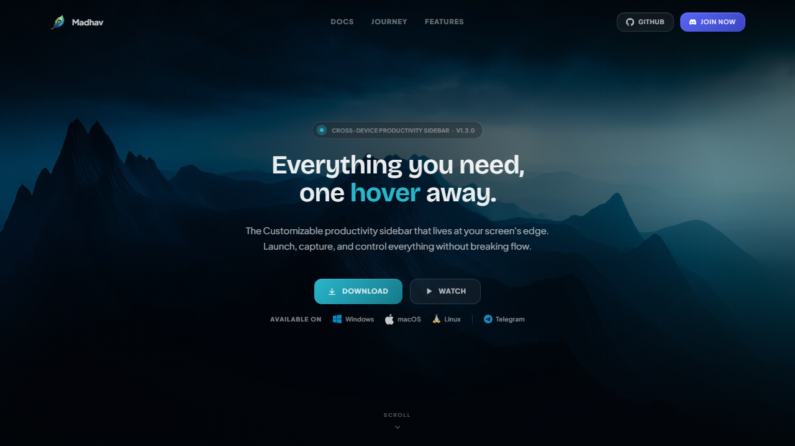
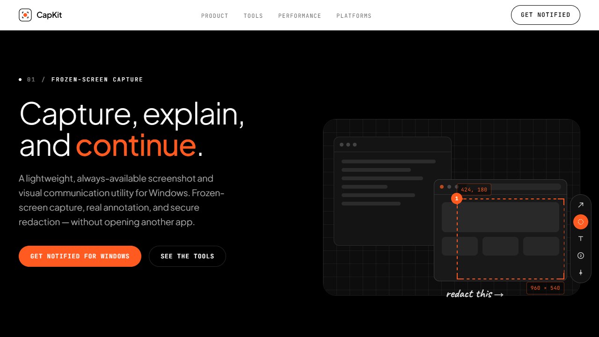
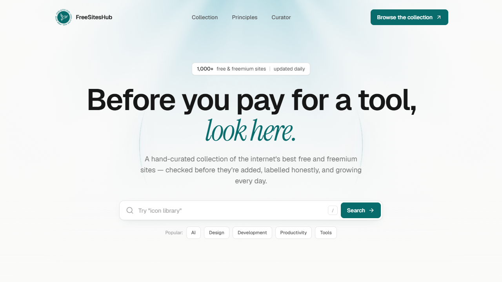
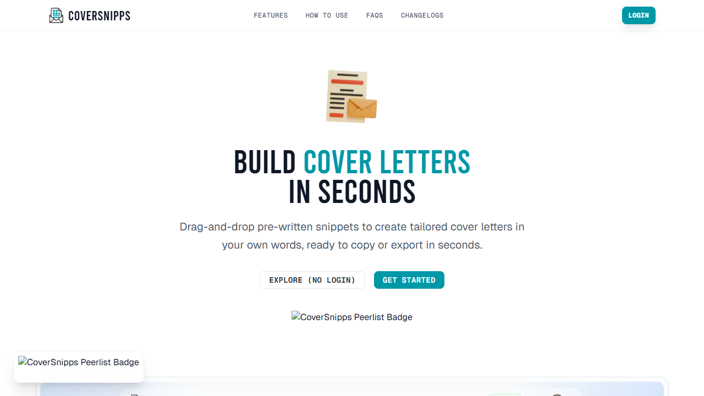
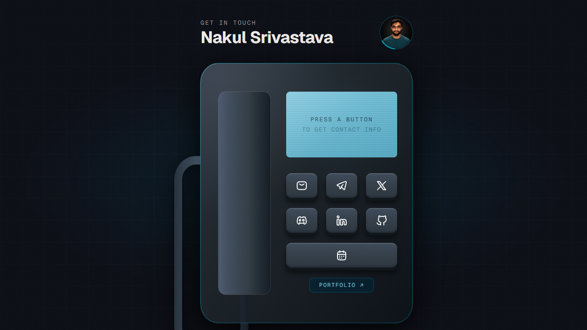
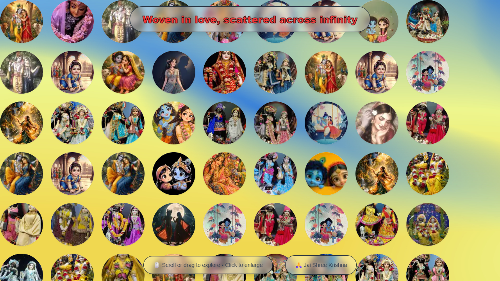
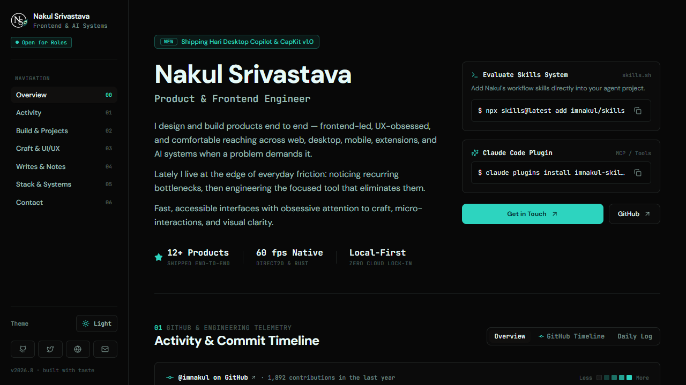

## Hi, I'm Nakul

- Working on **[Hari](https://github.com/imnakul/hari---Multiagent-Harness-with-Task-Session-Manager)**: a multi-agent harness with a task and session manager for coding agents

----

  

<b>Madhav</b> 
Local-first productivity sidebar for notes, tasks, ideas, bookmarks and reminders, with Telegram sync, OCR and voice capture. 
Windows · macOS · Linux &nbsp;·&nbsp; <a href="https://madhav.app">Website</a> · <a href="https://github.com/imnakul/madhav-releases">Releases</a>

 

  

<b>Venu</b> &nbsp; 
Hardware-accelerated Dynamic Notch for Windows with live blur, media controls and notifications. 
Windows · Rust &nbsp;·&nbsp; <a href="https://venu.nakulsrivastava.com">Website</a> · <a href="https://github.com/imnakul/venu---Dynamic-Notch-for-Windows">GitHub</a>

 

  

<b>Capkit</b> &nbsp; 
Lightweight capture toolkit for screenshots, screen recording, showcases and drawing on screen. 
Windows &nbsp;·&nbsp; <a href="https://capkit.nakulsrivastava.com">Website</a> · <a href="https://github.com/imnakul/Capkit">GitHub</a>

 

  

<b>Smaran</b> &nbsp; 
Offline-first app for reminders, learnings, quotes and habits, with optional two-way Notion sync. 
Android &nbsp;·&nbsp; <a href="https://smaran.nakulsrivastava.com">Website</a> · <a href="https://github.com/imnakul/Smaran---Remember-what-matters">GitHub</a>

 

  

<b>Local Claude &amp; Codex Analytics</b> &nbsp; 
Privacy-first local dashboard for Claude Code and Codex sessions, token usage and cost estimates. 
Local web app &nbsp;·&nbsp; <a href="https://github.com/imnakul/claude-codex-analytics">GitHub</a>

 

  

<b>FreeSitesHub</b> 
A hand-curated collection of 1,000+ free and freemium products, built up over about two years. 
Web &nbsp;·&nbsp; <a href="https://fsh.nakulsrivastava.com">Website</a>

 

  

<b>CoverSnipps</b> 
Build tailored cover letters in seconds from drag-and-drop, pre-written snippets. 
Web &nbsp;·&nbsp; <a href="https://coversnipps.site">Website</a>

 

  

<b>Retro Telephone</b> 
A contact page reimagined as a retro desk telephone with a modern touch. Press a button to reach me. 
Web &nbsp;·&nbsp; <a href="https://contact.nakulsrivastava.com">Website</a>

 

  

<b>Garland of Infinite Love</b> 
Woven in love, scattered across infinity. An endless, draggable gallery devoted to Shyama-Shyam. 
Web &nbsp;·&nbsp; <a href="https://hss.nakulsrivastava.com">Website</a>

 

  

<b>Krishna Leela</b> 
An immersive 3D journey through the life of Krishna from the Bhagavata Purana, told as twelve painted scenes you scroll through. 
Web · 3D &nbsp;·&nbsp; <a href="https://krishna-janamleela.vercel.app">Website</a>

 

  

<b>Docs-style Portfolio</b> 
Developer portfolio in the style of Matt Pocock's AI Hero docs, with a live GitHub heatmap and light/dark themes. 
Next.js · Tailwind &nbsp;·&nbsp; <a href="https://doc-style-portfolio.vercel.app">Website</a> · <a href="https://github.com/imnakul/doc-style-portfolio">GitHub</a>

---

