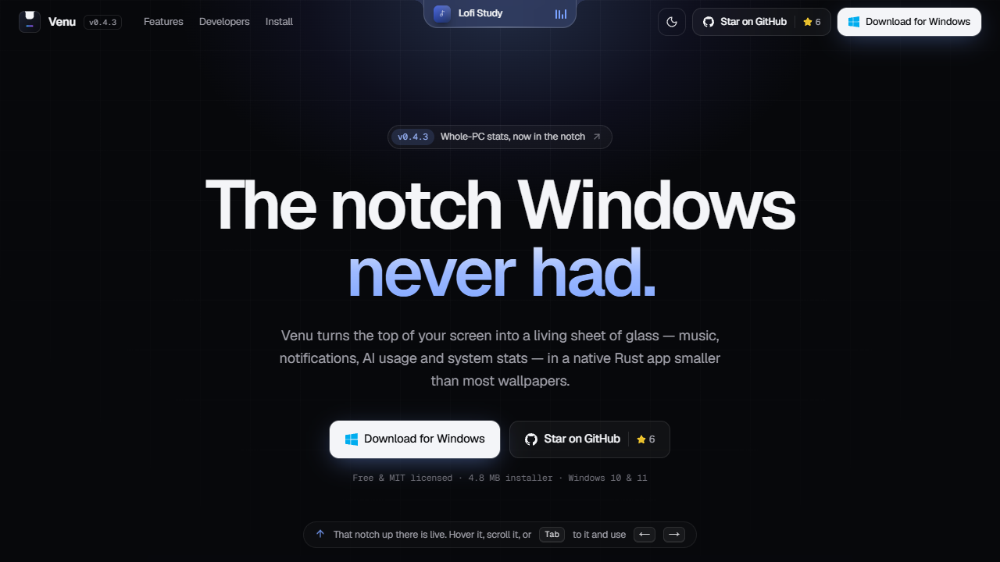
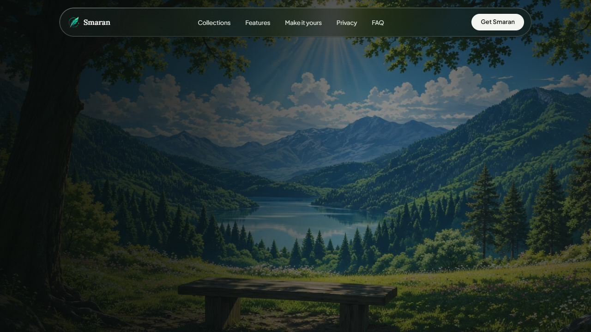
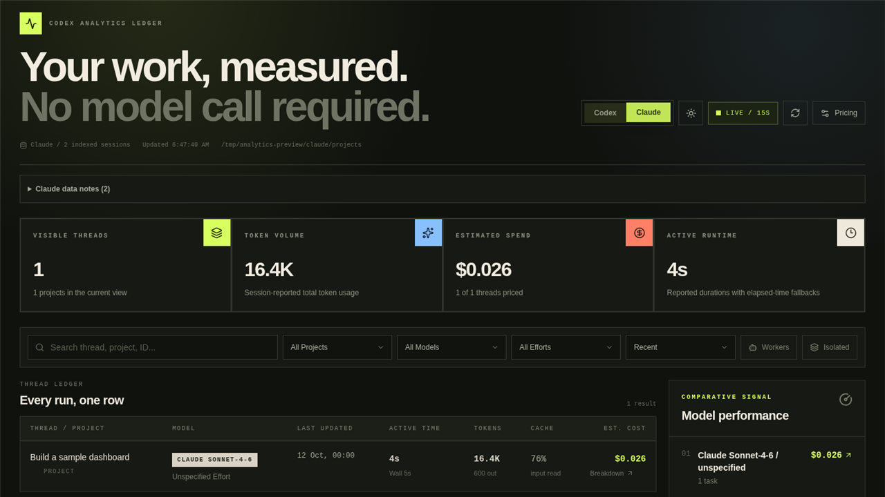

## Hi, I'm Nakul

**Product-focused developer & frontend architect.** I build free, local-first tools for desktop, mobile and the web.

[nakulsrivastava.com](https://nakulsrivastava.com) · [X](https://x.com/imnakul) · [Peerlist](https://peerlist.io/imnakul)

---

### Products

<table>
  <tr>
    <td width="50%" valign="top">
      
      <h4>Madhav</h4>
      Local-first productivity sidebar for notes, tasks, ideas, bookmarks and reminders, with Telegram sync, OCR and voice capture. 
      Windows · macOS · Linux 
      <a href="https://madhav.app">Website</a> · <a href="https://github.com/imnakul/madhav-releases">Releases</a>
    </td>
    <td width="50%" valign="top">
      
      <h4>Venu</h4>
      Hardware-accelerated Dynamic Notch for Windows with live blur, media controls and notifications. 
      Windows · Rust 
      <a href="https://venu.nakulsrivastava.com">Website</a> · <a href="https://github.com/imnakul/venu---Dynamic-Notch-for-Windows">GitHub</a>
    </td>
  </tr>
  <tr>
    <td width="50%" valign="top">
      
      <h4>Capkit</h4>
      Lightweight capture toolkit for screenshots, screen recording, showcases and drawing on screen. 
      Windows 
      <a href="https://capkit.nakulsrivastava.com">Website</a> · <a href="https://github.com/imnakul/Capkit">GitHub</a>
    </td>
    <td width="50%" valign="top">
      
      <h4>Smaran</h4>
      Offline-first app for reminders, learnings, quotes and habits, with optional two-way Notion sync. 
      Android 
      <a href="https://smaran.nakulsrivastava.com">Website</a> · <a href="https://github.com/imnakul/Smaran---Remember-what-matters">GitHub</a>
    </td>
  </tr>
  <tr>
    <td width="50%" valign="top">
      
      <h4>FreeSitesHub</h4>
      A hand-curated collection of 1,000+ free and freemium products, built up over about two years. 
      Web 
      <a href="https://fsh.nakulsrivastava.com">Website</a>
    </td>
    <td width="50%" valign="top">
      
      <h4>CoverSnipps</h4>
      Build tailored cover letters in seconds from drag-and-drop, pre-written snippets. 
      Web 
      <a href="https://coversnipps.site">Website</a>
    </td>
  </tr>
  <tr>
    <td width="50%" valign="top">
      
      <h4>Local Claude & Codex Analytics</h4>
      Privacy-first local dashboard for Claude Code and Codex sessions, token usage and cost estimates. 
      Local web app 
      <a href="https://github.com/imnakul/claude-codex-analytics">GitHub</a>
    </td>
    <td width="50%" valign="top">
      
      <h4>Docs-style Portfolio</h4>
      Developer portfolio in the style of Matt Pocock's AI Hero docs, with a live GitHub heatmap and light/dark themes. 
      Next.js · Tailwind 
      <a href="https://doc-style-portfolio.vercel.app">Website</a> · <a href="https://github.com/imnakul/doc-style-portfolio">GitHub</a>
    </td>
  </tr>
</table>

### Currently building

- **[Hari](https://github.com/imnakul/hari---Multiagent-Harness-with-Task-Session-Manager)**: a multi-agent harness with a task and session manager for coding agents

---

TypeScript · React · Next.js · Rust · Tailwind · Node.js · Supabase · Firebase
